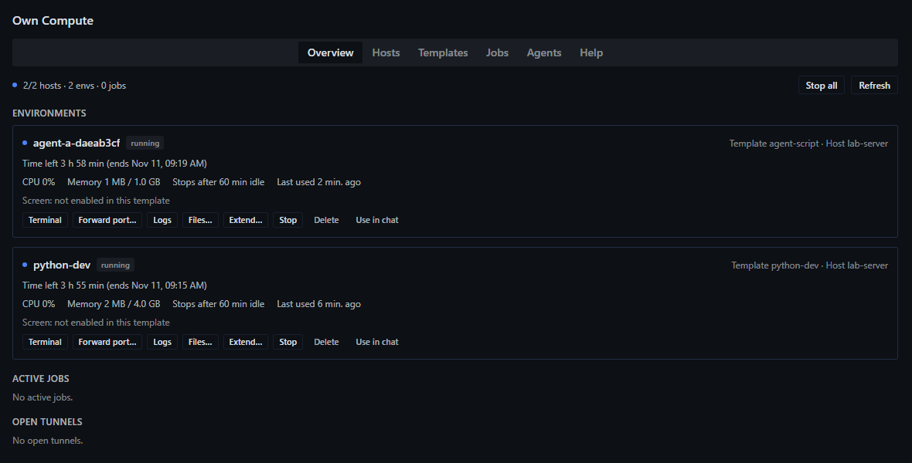
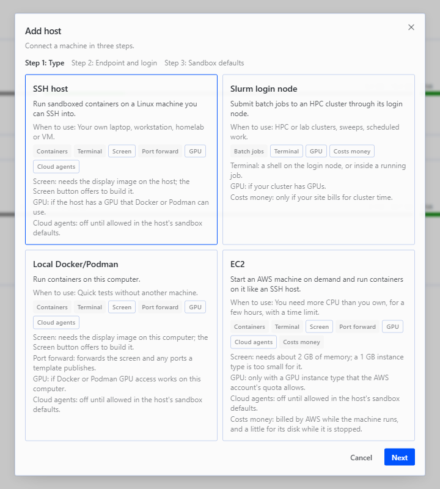
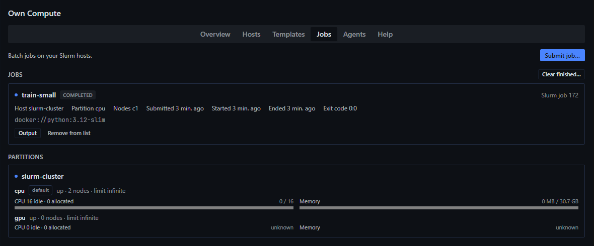
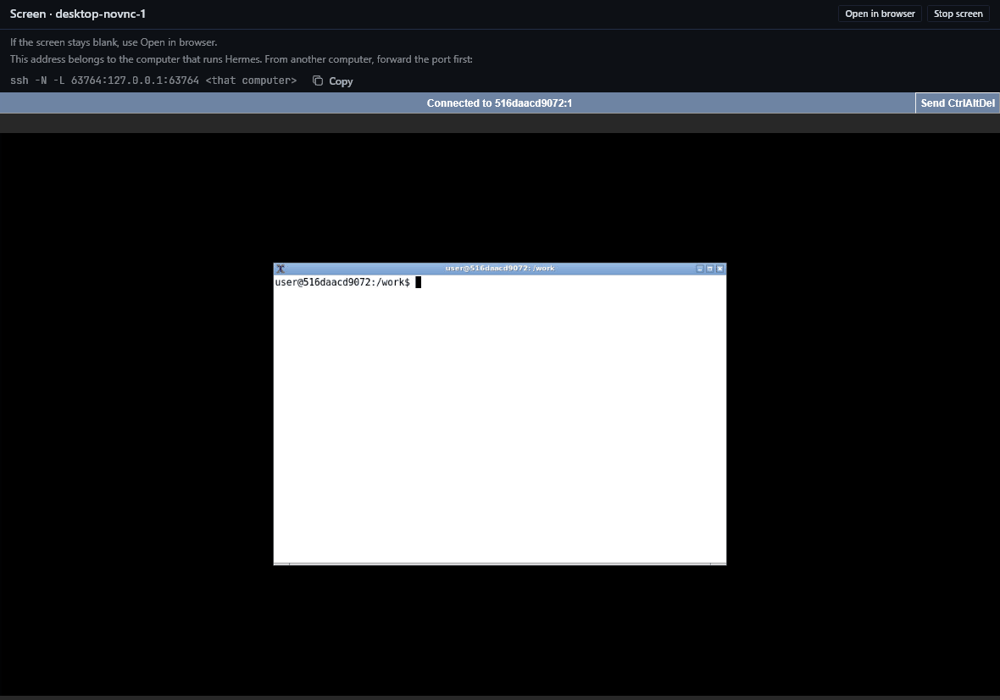
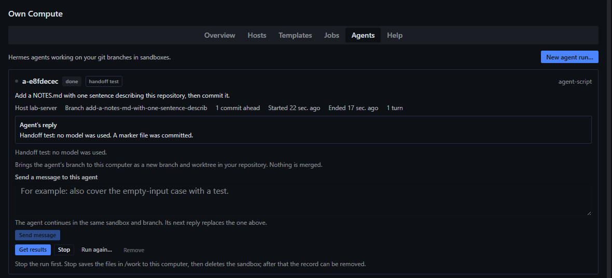
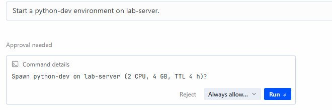

# Own Compute

**Bring your own compute.**

Own Compute is a Hermes Agent plugin for researchers and scientists who have a workstation, a lab server or a cluster account and want Hermes to use it. Hermes can start sandboxed container environments and submit Slurm batch jobs there, from chat or from a Compute page in Hermes Desktop that shows every machine and what runs on it. The machines can be SSH hosts, Slurm login nodes, the Docker or Podman on this computer, and EC2 machines that the plugin starts in an AWS account the user owns. Hermes can also give a task to a cloud agent: a Hermes agent that works in a sandbox on one of those machines and hands its work back as a git branch. Cloud agents here run on the user's own machines, not in Hermes Cloud or any hosted service. Every action that starts, changes or deletes something shows an approval card first. Everything runs on machines the user owns or has an account on. The plugin bills nothing and talks to no service run by its author. An EC2 host costs money: AWS bills the user's account (see [EC2 host](#ec2-host)). It is an independent plugin and is not a Nous Research product.

The internal plugin id is `cloud-compute`. It appears in the settings path `plugins.entries.cloud-compute`, the data folder `plugin-data/cloud-compute`, labels on remote machines and image names. It is not a second product.



## What it can do

- **Environments.** Start a container from a template (image, CPU, memory, GPU, network, time limit, idle timeout, optional screen) on an SSH host or on this computer. Run commands, read logs, stop, start, extend, delete.
- **Files and saved copies.** Browse an environment's `/work` folder, download, upload, and save it to this computer. Delete saves first and verifies the copy.
- **Screens, terminals and port forwards.** Open a terminal window, a remote desktop (noVNC) or a forward to a container port, all on `127.0.0.1`.
- **EC2 hosts.** Start one AWS machine per host on demand, use it as an SSH host with Docker on it, and stop or terminate it. The machine stops itself at a time limit. AWS bills the user's account for it.
- **Slurm jobs.** Submit, list, read output, cancel and get a notification when a job ends, through a login node. Job arrays and Apptainer images are supported.
- **Cloud agents.** Give a task and a git repository on this computer to a headless Hermes agent that works in a sandbox on one of the hosts. Fetch its commits as a local branch.
- **Chat tools.** 15 tools, a `/compute` command and a bundled guide skill. The model sees which machines are online and can use them after approval.
- **Limits.** Time limits stop environments and keep their files. Host limits, idle stops and a **Stop all** button bound what runs.

## Requirements

- Hermes Agent 0.23.0 or newer (`requires_hermes: ">=0.23.0"`) with the Desktop app or the Webapp.
- `ssh` on the computer that runs the Hermes gateway for SSH and Slurm hosts, and `git` for cloud agents. The gateway has to run on the same computer that shows the Compute page, because terminals and port forwards open on it.
- For SSH hosts: Linux with Podman (rootless works) or Docker, reachable by `ssh` without a password prompt (a key in the SSH agent).
- For Slurm login nodes: `sbatch`, `squeue`, `sacct` and `scancel` in a login shell. Apptainer is optional.
- For the local host: Docker Desktop or Podman, installed and running on this computer.
- For EC2 hosts: an AWS account, an IAM user made for this plugin (never the root user) with the policy in [docs/ec2-iam-policy.json](docs/ec2-iam-policy.json), and its access key stored as the Hermes secrets `AWS_ACCESS_KEY_ID` and `AWS_SECRET_ACCESS_KEY`. `ssh` and `ssh-keygen` on the computer that runs the gateway.
- No Python packages beyond the standard library. `asyncssh` is an optional extra that the setting `use_asyncssh` can switch on.

## Install

```
hermes plugins install Siioh/hermes-own-compute --enable
```

The plugin has two halves, the Agent half (chat tools) and the Desktop half (the Compute page). Each has its own switch.

1. In Hermes Desktop or the Webapp, open **Capabilities > Plugins** and press the refresh button (**Rescan**).
2. Open **Filters**, turn on **Installed**, then open **Own Compute**. The unfiltered catalog search does not list it.
3. Turn on the **Agent** switch, then the **Desktop** switch. The Desktop switch is stored per browser or app, so a new browser needs it turned on again.
4. If the Agent switch was turned on after the gateway started, restart the gateway.
5. Start a **new chat**. Tools of a newly enabled plugin appear in the next chat.

`hermes plugins enable cloud-compute` turns on the Agent half only. **Compute** appears in the sidebar once the Desktop half is on.

To update, restart the gateway and run **Rescan**. The plugin does not update itself.

## Quick start

Open **Compute** in the sidebar. The first-run page walks through **+ Add host** in three steps: type, endpoint and login, sandbox defaults. **Test connection** checks name lookup, the network port, login, the container runtime or scheduler, screen support and GPUs, and says what to fix.



### SSH host

1. **+ Add host**, **SSH host**, then an alias from the SSH config (for example `gpu-box`) or a host and user. A key file and a jump host are optional.
2. **Test connection**. A host that needs a password, passphrase or second factor shows **Needs login**: run `ssh gpu-box` once in a terminal, finish the login, then press Retry. A key loaded in the SSH agent avoids the prompt.
3. Set the host's limits (maximum environments, CPU and memory) and whether cloud agents are allowed, then save.
4. **Templates**, **Spawn on...**, pick the host. Or ask in chat: "Start a python-dev environment on gpu-box."

The first start of a template pulls its image on the host. Details: [docs/hosts.md](docs/hosts.md).

### Slurm login node

1. **+ Add host**, **Slurm login node**, the same endpoint and login as an SSH host. Partition, account and QOS are optional.
2. Set the **Work directory** to a folder on storage that the compute nodes also see (shared storage, often a project, scratch or `/data` path). The default `~/cloud-compute` fails on clusters where home folders are not shared. **Test connection** checks this by writing a small file on the login node and reading it from a compute node.
3. **Jobs**, **Submit job...**: a command or script, an optional image (`docker://...` or a `.sif` path), partition, CPUs, memory, time limit and an optional array such as `1-10%2`.

Job output is read from the job folder `<work directory>/<job id>`. Slurm hosts have no sandboxes, no screens and no cloud agents. A second factor is not automated: log in once in a terminal.

### This computer with Docker or Podman

1. Install Docker Desktop or Podman and start it. `docker version` or `podman version` has to answer in a terminal.
2. **+ Add host**, **Local Docker/Podman**, **Test connection**. There is nothing to log in to.
3. Spawn from **Templates** as for an SSH host. The screen and port forwards use ports bound to `127.0.0.1`.

If the host shows **Degraded**, the page says why, for example "Docker is installed but not running. Start Docker Desktop, then test again."

### EC2 host

An EC2 host is an AWS account, a region and launch settings. **Start machine** launches one AWS instance; once it is ready it behaves like an SSH host with Docker on it. **AWS bills the user's account while the machine runs, for its disk while it exists (also while it is stopped) and possibly for a public address.** The plugin cannot see AWS prices or whether a free allowance applies. Check the AWS billing page and set a budget alert.

1. In AWS, make an IAM user for this plugin and attach [the policy](docs/ec2-iam-policy.json) as a customer managed policy, after putting your region and instance types into it. Store the user's access key as the Hermes secrets `AWS_ACCESS_KEY_ID` and `AWS_SECRET_ACCESS_KEY`.
2. **+ Add host**, **EC2**: region, instance type (default `t3.micro`), disk (default 10 GB), maximum lifetime (default 2 hours) and idle stop (default 30 minutes with no running environment). The wizard can list the instance types that AWS reports as free-tier eligible for the account. **Test connection** reads the account and checks a launch with a DryRun; nothing starts.
3. **Start machine** on the host card. The card shows "Launching the instance", then "Running; waiting for the AWS status checks" (about 2.5 minutes), then ready. Spawn environments on it as on an SSH host.
4. **Stop machine** keeps the disk, which AWS still bills. **Terminate machine** deletes the instance and its disk. If environments exist, the page asks first: **Save all and terminate** deletes them after saving each one's files to this computer, and **Terminate without saving** is a separate choice.

More: [docs/ec2.md](docs/ec2.md).

## Environments, files and saved copies

An environment is one container with a working folder, `/work`. Built-in templates are `ubuntu-dev`, `python-dev`, `desktop-novnc` and `slurm-python`; edit one to save a version of your own, or make a new template from an image. Before anything starts, **What will be sent** lists the image, limits, ports and the names (not values) of variables.

- **Time limit and idle timeout.** At either limit an environment is stopped and its files stay; nothing is deleted. A warning with an **Extend** button appears shortly before.
- **Save before delete.** **Delete** saves `/work` to this computer first, reads the archive back to verify it, and deletes nothing if that fails. **Delete without saving** is a separate choice behind a second confirmation. Only `/work` is saved; keep results there.
- **Files...** browses folders, downloads, uploads after a confirmation, saves with the size and file count shown first, restores a saved copy into any environment and deletes saved copies.
- **Where copies go.** Saved copies are `.tar.gz` files in the exports folder inside the plugin's data folder. The setting `exports_dir` moves them to another folder on this computer. The Hermes home folder and the SSH folder are refused as save destinations and as upload sources.



## Screens, terminals and port forwards

- **Terminal** opens a window on this computer that runs `ssh -t <host>` into the container: Windows Terminal or Command Prompt on Windows, Terminal on macOS, the usual terminal emulator on Linux. On Slurm hosts, **Open shell** opens a login-node shell. If no window can open, the command is placed on the clipboard.
- **Screen** shows the desktop of an environment started from the `desktop-novnc` template, in a tab. The first use builds a display image on the host.
- **Forward port** makes a container port available at `127.0.0.1` on this computer. A template lists the ports it publishes. Tunnels close after `tunnel_ttl_minutes` (default 60).



**Using the page from another computer.** Terminals, screens and forwards belong to the computer that runs the Hermes gateway. When the Webapp is opened from a different computer, forward the port first with the command the page shows, `ssh -N -L <port>:127.0.0.1:<port> <that computer>`. A terminal opens on the gateway computer's desktop; set `default_terminal` to `copy` to get the command instead.

## Cloud agents

A cloud agent is a headless Hermes agent in a sandbox on one of the hosts. It runs on the user's own machine, not in Hermes Cloud or any hosted service. It works on a copy of a git branch from a repository on this computer, and its commits come back as a local branch.

**What it needs**

- A model from an API-key provider, or a model server the user runs. A sign-in or subscription provider cannot be used: the sign-in lives on this computer and cannot be sent to a remote sandbox.
- The key stored as a Hermes secret under a name, by default `CC_AGENT_API_KEY` (Settings, Own Compute, **Cloud agent model key**). A model that the Hermes profile already offers uses its own key secret. Use a scoped, spend-capped key.
- **Allow cloud agents** on the host (off by default; not possible on Slurm hosts).

**Run one.** **Agents**, **New agent run...**: describe the task, pick the host, the template, the repository path and a branch. The **Model** list in the dialog offers a saved choice, a model from this Hermes profile, or another endpoint typed in and kept with **Save this choice**. The approval card names the model, endpoint, turn limit, repository and task. When the turn ends the card shows the agent's reply. **Send a message** continues the run, **Run again...** repeats it with another model or host, **Get results** fetches the commits as `refs/heads/cloud/<run>/<branch>` plus a sibling git worktree, and **Stop** fetches new commits, saves `/work` and removes the sandbox. Nothing is merged and no existing branch moves. The **Handoff test (no model)** template proves the branch round trip without a model.



The sandbox gets no push credentials. The first run on a host builds an image of several gigabytes. More: [docs/cloud-agents.md](docs/cloud-agents.md).

## Using it from chat

Tools: `compute_status`, `compute_host`, `env_spawn`, `env_exec`, `env_control`, `env_files`, `env_open`, `slurm_submit`, `slurm_jobs`, `cloud_agent_spawn`, `cloud_agent_status`, `cloud_agent_message`, `cloud_agent_rerun`, `cloud_agent_collect`, `cloud_agent_stop`. Hermes may offer plugin tools through its deferred tool lookup, which costs the model one extra step. `/compute` prints a summary (`/compute status`, `/compute hosts`, `/compute jobs`) and the skill `cloud-compute:guide` lists every parameter.

When Hermes approvals are on, an approval card appears before: starting, extending or deleting an environment; submitting or cancelling a Slurm job (the card shows the command or script); starting, stopping, re-running or messaging a cloud agent; adding, changing or removing a host (an EC2 host's card states the cost); starting, stopping, extending or terminating an EC2 machine; testing an address that is not saved; uploading, restoring or deleting saved files; saving into a folder; forwarding a host's port. An answer of "session" or "always" covers only the same action with the same values. The buttons on the Compute page need no card.



Host command prefixes, saved model choices and an EC2 host's image, subnet, security group and SSH user are set on the page only. Chat refuses AWS key values: store them as Hermes secrets. From chat, an EC2 host can name only secrets called `AWS_ACCESS_KEY_ID`, `AWS_SECRET_ACCESS_KEY` or starting with `AWS_`. The model has no shell on any host and cannot run commands in a cloud agent's sandbox.

## Settings

Under **Settings, Own Compute**, or `plugins.entries.cloud-compute.settings.<name>` in the Hermes configuration. All settings are in [docs/settings.md](docs/settings.md). The ones most users change:

| Setting | Default | Meaning |
|---|---|---|
| `approval` | `always` | `remote-only` skips cards for hosts on this computer, except deleting |
| `default_ttl_minutes` | 240 | Maximum lifetime of a new environment or agent |
| `default_idle_minutes` | 60 | Idle stop of a new environment or agent |
| `auto_delete_days` | 0 | Delete environments stopped this long, after saving; 0 is off |
| `exports_dir` | empty | Folder for saved copies; empty uses the plugin data folder |
| `agent_base_url`, `agent_model` | empty | Model used when a template names none |
| `default_terminal` | `auto` | How to open a terminal; `copy` only copies the command |

## Data and safety

- **Files are saved before anything is deleted, and the save is verified.** If it fails, nothing is deleted. Time limits and idle timeouts stop environments and keep their files. Automatic deletion is off unless `auto_delete_days` is above 0, and it saves first.
- **Secrets are referenced by name.** A variable can read a Hermes secret (`secret:NAME`) and is sent only into the environment of that template, after the box **Send these secrets into the environment** is ticked. The value travels over SSH standard input into a private file that is deleted when the container has started. It is not in a command line, a log, the database, an event or a git bundle. Output is checked for the values before it reaches chat; if the values cannot be read back, the output is withheld.
- **Approvals.** The list is in [Using it from chat](#using-it-from-chat). With Hermes approvals switched off (`approvals.mode: off`), these chat requests run without a card. The Compute page then shows a red notice at the top.
- **Limits of the redaction.** A secret is hidden when it is printed as it is. A command that changes it first (for example by encoding it) can get it past the check. Give an environment only secrets the chat model may see.
- **Cloud agent key.** The agent's model key is in the environment of its sandbox, so a command that the agent itself runs there can read it. Use a key with a spending cap and a narrow scope. The key is hidden in everything the run shows, and the agent's own state folders are left out of saved copies.
- **EC2 machines stop themselves.** Every machine has a stop timer of its own, and the plugin enforces the limit while Hermes runs. A stopped machine still bills for its disk. [docs/ec2.md](docs/ec2.md) says what the timer covers and what it does not.
- **Ports stay on loopback.** Published ports and tunnels bind `127.0.0.1`. A screen link carries a random per-environment token.

Details: [docs/safety.md](docs/safety.md).

## Disclosures

**Network calls.**
- SSH from this computer to the hosts the user added, carrying the commands listed below, and a TCP connection to each host's SSH port for quick reachability checks (default every 15 s) and for **Test connection**, which also resolves the host name. The first contact with a host adds its host key to the user's SSH known-hosts file (`StrictHostKeyChecking=accept-new`); a changed key is refused.
- Container images are pulled by the container runtime on the hosts, from the registries the templates name. The built-in templates use `docker.io/library/ubuntu:24.04` and `docker.io/library/python:3.12-slim`. The cloud agent image builds on `docker.io/nousresearch/hermes-agent:v0.23.0` (pinned by digest) or, for the handoff test, `python:3.12-slim`; if the base has no git, the build installs it with the base image's package manager. The display image builds on `debian:bookworm` and installs Debian packages. Apptainer on a Slurm host may pull `docker://` images the user names.
- The model endpoint the user configures is contacted from inside a cloud agent sandbox only, with the model key. The plugin makes no request to it from this computer.
- Local loopback: `ssh -L` tunnels, published container ports on `127.0.0.1`, one HTTP request to a screen's loopback address to see that it answers, and the **Open in browser** button, which opens the default browser on that address.
- EC2 hosts only: HTTPS calls from this computer to the AWS endpoints of the host's region (`ec2.<region>.amazonaws.com`, `sts.<region>.amazonaws.com` and `ssm.<region>.amazonaws.com`, which gives the public image ids), signed with the user's AWS key; and one lookup of this computer's public address at `https://checkip.amazonaws.com` for the SSH rule of the security group (skipped when the user types the address). Redirects are refused and an AWS call times out after 30 s. SSH goes from this computer to the instance's public address. At first boot the instance itself downloads Docker (Amazon Linux) or Podman (Ubuntu) from the image's package repositories. A host that is not an EC2 host makes none of these calls.
- Nothing else. No call goes to the plugin's author, there are no update checks and no telemetry.

**Spending.** The plugin bills nothing. Cost comes from the user's own compute (power, rented machines, a cluster allocation); from the model provider that the key belongs to, when cloud agents run; and from AWS, for EC2 hosts. EC2 is the one place where using the plugin directly causes charges on the user's AWS account: AWS bills the account for the machine while it runs, for its disk while it exists (also when stopped) and possibly for a public address, and the plugin cannot see prices or free allowances. Every EC2 action asks for approval in chat, and its card states the cost. Bounds: host limits, environment time and idle limits, Slurm time limits, **Stop all**, approval before a spawn, a submit, an agent run and every EC2 action, an EC2 host's maximum lifetime and idle stop, a ceiling on Extend (twice the maximum lifetime from the last start), the tag-scoped IAM policy, and a budget alert that the user sets in AWS.

**Credentials.**
- SSH uses the user's existing SSH configuration, agent and key files. A key file path may be saved with a host; keys, passphrases and passwords are not stored or copied. `ssh` and `git` child processes get an environment without secret-looking variables.
- Secrets come from the Hermes secret store through its public API, by name, at the moment of use, and are not cached or stored. Optional secrets declared by the plugin: `CC_AGENT_API_KEY` (cloud agent model key) and `HF_TOKEN` (for templates that name it). A template may name others.
- EC2 hosts: the AWS access key is read from the Hermes secrets named in the host (`AWS_ACCESS_KEY_ID`, `AWS_SECRET_ACCESS_KEY`, optional `AWS_SESSION_TOKEN`) at the moment of each AWS call. Key values are not stored, not sent into a sandbox or an instance, and not placed in a command line. Chat refuses them. Use an IAM user made for this plugin, never the root user.
- EC2 hosts: the plugin generates an ed25519 SSH key pair per host with `ssh-keygen` (no passphrase) and keeps the private key in the plugin data folder, in `ec2/<host id>/` (mode 0600 in a folder of mode 0700 on Linux and macOS; on Windows the folder's inherited permissions apply, which were not checked). Only the public key goes to AWS. The folder is removed with the host. The instance's SSH host key is read from the console output and pinned in a `known_hosts` file in the same folder; when the console does not show it, the first login records the key it sees.
- A secret reaches a host as a file with mode 0600 in `$HOME/.cache/cloud-compute` (folder mode 0700) on that host, passed to the container runtime and deleted after the container starts. A sweep by the reaper removes leftovers older than 15 minutes. On a local host the file is in the same folder on this computer, or in the plugin data folder on Windows.
- The Hermes home folder, the Hermes configuration and the SSH folder are refused as upload sources and as save destinations.
- Written on this computer, in the plugin data folder (`plugin-data/cloud-compute` in the Hermes home; folder mode 0700 and files mode 0600 on Linux and macOS): a SQLite database with hosts (including the path of an optional key file and a jump host), templates (secret names), environments, jobs, tunnels, events, run records and the index of saved copies, plus the random screen token of each environment; and the exports folder with the saved copies.

**Background processes.**
- One daemon thread starts on the first plugin tool call, chat turn or request from the page, and stops when the plugin unloads or Hermes exits. It checks host reachability every 15 s (`liveness_seconds`), probes hosts every 60 s (`poll_seconds`), gathers instance statistics and runs the reaper (time limits, idle stops, leftover files) every 60 s, polls cloud agents every 15 s, polls Slurm every 10 s while a job is open and otherwise at the host's interval (60 s by default, 30 s at least), and closes expired tunnels every 30 s. For EC2 hosts the same loop also checks every 20 s whether a machine that is launching, starting or stopping has lost its worker (Hermes quit or restarted meanwhile) and resumes it; asks AWS about a ready machine at most every 5 minutes, with its probe; and enforces the maximum lifetime and the idle stop. Starting or stopping a machine polls AWS every 5 s until the state has changed. Short-lived worker threads run the probes.
- Child processes on this computer: `ssh` for probes, commands and `-L` tunnels (a tunnel runs until it expires, is closed or its environment stops); `git` for cloud agent handoff; terminal windows the user opens (Windows Terminal or Command Prompt, Terminal on macOS, the usual emulator on Linux), with a short launcher script in a `cloud-compute-terminals` folder in the system temporary folder; `ps`, `tasklist` or `taskkill` to check and stop its own tunnel processes; `ssh-keygen` for EC2 hosts (once per host, at its first start); the local container runtime for a local host.

**Remote shell commands**, run over SSH on hosts the user added (and on this computer for the local host), by kind:
- Container runtime (`podman` or `docker`): `version`, `info`, `run`, `ps`, `stats`, `inspect`, `start`, `stop`, `rm`, `exec`, `cp`, `logs`, `port`, `build`, `image exists` or `image inspect`. Containers are managed only when they carry the plugin's labels.
- Inside those containers: the command a model or person runs (`sh -lc`), file listing and size commands, creating `/work`, and in agent sandboxes `git` and Hermes.
- Slurm: `sbatch`, `squeue`, `sacct`, `scancel`, `sinfo`, `scontrol show node`, `srun` (a terminal into a running job, and the one-CPU, one-minute check job of **Test connection** for the work directory), `apptainer --version`, and file commands in the job folder (`mkdir`, writing `job.sh`, `ls`, `tail`).
- Probes: `uname`, `nproc`, reads of `/proc` and `/etc/os-release`, `df`, `nvidia-smi`, `command -v`, `timeout`.
- Secret file helpers: `mkdir`, `chmod`, `cat`, `rm` and `find ... -delete` in `$HOME/.cache/cloud-compute`.
- EC2 instances: at first boot a script run by cloud-init (user data) arms a systemd timer that powers the machine off (`systemd-run --unit=cloud-compute-stop --on-active=<minutes>m --timer-property=AccuracySec=1s systemctl poweroff`), writes a systemd unit `cloud-compute-limit.service` that arms it again at every boot (`tee`, `systemctl daemon-reload`, `systemctl enable`), and installs a container runtime: `dnf install -y docker`, `systemctl enable --now docker`, `usermod -aG docker <user>` on Amazon Linux, or `apt-get update` and `apt-get install -y podman` on Ubuntu. Over SSH the plugin then sets the exact stop time with `sudo -n systemctl stop cloud-compute-stop.timer` and `sudo -n systemd-run` (the same timer), cancels a scheduled `shutdown` left by an older script with `sudo -n shutdown -c`, and rewrites the lifetime in that unit with `sudo -n sed -i` and `sudo -n systemctl daemon-reload`. After that the instance is an ordinary container host, with the runtime commands above.
- A command prefix that the user sets on a host (page only) is added before each command on that host, meant for a scheduler inside a container.

**Written on remote hosts.** Containers, volumes and images (agent image `localhost/cloud-compute-agent`, display image `localhost/cloud-compute-novnc`); on container hosts the folder `$HOME/.cache/cloud-compute`; on Slurm hosts a folder `<work directory>/<job id>` per job (default work directory `~/cloud-compute`) with `job.sh` and the output, and a short-lived test file in the work directory during **Test connection**. Removing a job from the list leaves its folder on the cluster. On AWS, for each EC2 host: one instance with its root volume (gp3), one key pair and one security group (SSH only, from this computer's address or the address the user typed), all tagged `cloud-compute:install` (the value is this install's id) and `cloud-compute:host` (the host id). The plugin changes or deletes no AWS resource that lacks the install tag; a subnet or security group that the user names is used, not changed. The instance and its volume are the only resources that cost money; they are deleted by **Terminate machine**. The key pair and the security group are deleted when the host is removed, if the AWS key is still stored.

**Written on this computer.** The plugin data folder (above); the exports folder (`exports_dir`); a temporary `cc-relay-*` folder while a git bundle is made; collected agent branches `refs/heads/cloud/<run>/<branch>` and a worktree folder next to the repository; the SSH known-hosts entries above; for EC2 hosts the key and `known_hosts` files above.

**What the plugin does not do.** No telemetry, no update check, no self-update, no patching of Hermes core, no compiled binaries, no tool or LLM overrides (`capabilities: []`), and no reading of the Hermes `.env` or `auth.json` files. It makes no AWS call for a host that is not an EC2 host, and creates no AWS resource until a machine is started, by a click on **Start machine** or after an approval card in chat.

## Platform status

Hermes v0.23.0. Each row was checked on a build made shortly before this release. Changes made after a check are covered by the automated tests (about 2,800), which ran on Windows. Every Slurm check used a Slurm test cluster running in containers (Slurm 26.05), no production cluster was used.

| Platform | What was tested | Not tested |
|---|---|---|
| Windows 11, Hermes Webapp in a browser | SSH host, Slurm test cluster, environments, files, saved copies, screen, terminal, port forwards, cloud agents on a real model, chat tools with approval cards | The native Hermes Desktop app; GPU |
| Windows 11, local Docker Desktop | One manual check on an earlier build: spawn, run commands, files, stop and start, delete with save, screen, terminal and a handoff-test agent, once `docker` could be found. Two path problems and a stale screen port after a restart were found then; the path fixes were re-checked by unit tests and a short live run (host test, spawn, run, delete) | The screen after a restart, cloud agents with a model, Podman on Windows, GPU |
| Linux, Fedora 43, rootless Podman | Local host, terminals, Slurm test cluster, handoff and model agents, file permissions, the Webapp used from another computer through ssh tunnels. Fixes made after the check were run live on the same host: the Podman 5.8 restore fix and the Desktop (noVNC) template's folder fix, on both an SSH host and the local host, and the follow-up turn-limit fix against a real model | Docker on Linux; GPU; a full second pass of the whole check |
| macOS 27.2, Apple Silicon | Docker Desktop as local host, Terminal, SSH host, Slurm test cluster, handoff and model agents, file names and permissions | iTerm (the plugin always opens Terminal); Podman, Colima, OrbStack; GPU |
| AWS EC2 (us-east-1, t3.micro, Amazon Linux 2023) | All runs used us-east-1, t3.micro and Amazon Linux 2023, from Windows 11 with Windows OpenSSH. 2026-11-10: three short launches through the plugin's code from a script (about 11 instance-minutes in total); the first two each found a bug (fixed); the third passed every check: connection test with a DryRun launch, launch, status checks, key pinning, SSH, Docker, an environment (spawn, run a command, save files and verify the copy, delete), stop, start again with a new address, terminate, and removal of the key pair and security group; it also extended the machine, but with the scheduled shutdown that the systemd timer replaced later. 2026-11-11, first run from the Compute page of a running Hermes (about 22 instance-minutes): keys by name through Hermes, launch, the machine stopped itself at its limit with Hermes closed, the card settled to Stopped, a second boot armed the stop again; it found problems (removing the environments of a stopped machine, spawning on an EC2 host from the page, a login block before the scheduled shutdown, no confirmation before Start, an EC2 host with no machine shown as offline). 2026-11-11, second run from the page after the fixes, on the code being published apart from the changes made after it (one launch, about 15 instance-minutes): wizard and connection test, confirmation dialog before Start, launch, spawn from the page, one stop timer with no login block, the machine stopping itself with Hermes closed, saving files in the last minutes, terminate without saving on a stopped machine, and host removal with the key pair and security group removed. Found there and fixed afterwards, checked by unit and page tests only: Extend offered when it could not work, and the Overview tab calling a host without a machine offline | Extend on a live machine with the systemd timer; the timer re-arming after a Stop and Start with the new timer; adding or starting a host from chat (the approval cards were shown and rejected, not executed); any other region, image or instance type; GPU types; AWS use from Linux or macOS; Ubuntu images |
| Hermes Desktop, native app | Not tested. The page was tested in the Hermes Webapp, which serves the same page code | Anything specific to the app |
| GPU | Not tested | |

## Known limits

- Slurm only (no PBS or LSF), no multi-node orchestration, no second-factor automation.
- Cloud agents are off on Slurm hosts. An agent's session is not imported into local chat history, and there is no usage accounting.
- Egress control is the template's network setting, default or none; there is no allow-list proxy.
- The gateway has to run on the computer that shows the page; terminals and forwards belong to it.
- Jobs on clusters without `sacct` end as "Ended (state unconfirmed)", without an exit code.
- A model sometimes writes a chat card as plain text such as `::cc-env{...}`; asking for the card on its own line shows it.
- A cloud agent's model key can be read by commands the agent itself runs; use a spend-capped key.
- EC2: prices and free allowances are not visible to the plugin. A stopped machine still bills for its disk. The machine's own stop timer (a systemd timer) was seen stopping a machine at its limit with Hermes closed on 2026-11-11; its re-arming after a Stop and Start, and Extend, have not been seen on a real machine. In the last minute before the stop time the machine may no longer take connections. A stopped machine that still holds environments is cleaned up without starting it: Terminate without saving, or delete an environment without saving. A machine that this computer cannot reach while Hermes is closed is stopped by the on-machine timer only, and that timer can run longer than the setting until the plugin reaches the machine. The root volume of a terminated instance cannot be listed with the shipped IAM policy: check the AWS console for leftover volumes.
- Hermes tools may need an extra lookup step before a model can call them.
- A model server that unloads when idle can make the first agent call fail; warm it first.

## Troubleshooting

| Problem | What to do |
|---|---|
| No **Compute** entry, or "the backend is missing" | Turn on the **Agent** and **Desktop** switches in Capabilities > Plugins, run `hermes plugins enable cloud-compute` if needed, restart the gateway, reload. |
| **Needs login**, or "Host key verification failed: connect once with ssh in a terminal to accept the host key" | Run `ssh <alias>` in a terminal, finish the login or accept the key, press Retry. |
| **Degraded** | The machine answers but the runtime or scheduler fails. Open the host to see the failed row. Local host: "Docker is installed but not running. Start Docker Desktop, then test again." |
| "Work directory check failed ... job output written there cannot be read back" on a Slurm host | Edit the host and set **Work directory** to storage that the login and compute nodes share, then **Test connection**. |
| A cloud agent run fails: "No model is set up for cloud agents", or "The model endpoint ... answered 404: model ... was not found there" | Pick a model in **New agent run, Model**, or set the model settings; check the model id; **Run again...** with the right one. |
| An EC2 host shows an error, or a machine stays in "Starting" | Open the host card and press **Check AWS**. It lists machines with this install's tag that no host tracks, with Stop and Terminate buttons. A machine that is still running bills until it is stopped or terminated. See [docs/ec2.md](docs/ec2.md). |

More cases (terminal does not open, screen is blank, port forward fails, environment will not start): [docs/troubleshooting.md](docs/troubleshooting.md).

## Documentation

[docs/README.md](docs/README.md) indexes the guides: [hosts](docs/hosts.md), [EC2](docs/ec2.md), [cloud agents](docs/cloud-agents.md), [safety](docs/safety.md), [settings](docs/settings.md), [troubleshooting](docs/troubleshooting.md). The same topics are in the Help tab of the Compute page.

## License

MIT. See [LICENSE](LICENSE). Author: Tyler Ramsarran.
